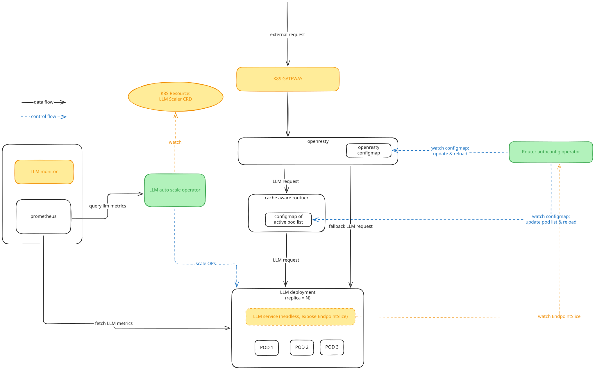

# llmscaleoperator

[](https://github.com/modelsphere/llm-operator/actions/workflows/release.yml)
[](dist/chart/Chart.yaml)
[](https://github.com/modelsphere/llm-operator/pkgs/container/llm-operator)
[](https://hub.docker.com/r/4pdosc/llm-operator)
[](https://hub.docker.com/r/4pdosc/llm-operator)
[](https://github.com/modelsphere/llm-operator/pkgs/container/charts%2Fllmscaleoperator)
[](go.mod)
[](LICENSE)
[](https://github.com/modelsphere/llm-operator/stargazers)


A Kubernetes operator that autoscales LLM inference workloads (e.g. vLLM) on
LLM-specific signals — KV-cache utilization, queue depth, TPM/capacity load —
rather than CPU/memory. Think of it as an HPA specialized for token-serving.



## Images and releases

The image is `4pdosc/llm-operator` on Docker Hub, the default everywhere in this
repo. Tagging `vX.Y.Z` publishes it through `.github/workflows/release.yml`.

The release workflow refuses a tag that does not match `appVersion` in
`dist/chart/Chart.yaml`. The chart leaves `manager.image.tag` empty so it follows
`appVersion`; a tag that disagrees would publish one build and install another.

To run your own build instead of the public image:

```bash
# Helm
helm install llmscaleoperator ./dist/chart \
  --set manager.image.repository=<registry>/llm-operator

# Makefile targets
make deploy IMG=<registry>/llm-operator:<tag>
```

The Dockerfile's two base images are build args, defaulting to the public
`golang` and `gcr.io/distroless/static`. Point them at a mirror where those
registries are unreachable:

```bash
docker build \
  --build-arg GO_IMAGE=<mirror>/golang:1.26 \
  --build-arg RUNTIME_IMAGE=<mirror>/distroless-static:nonroot .
```

## Description

The operator introduces two CRDs.

- **`LLMService`** (`serving.modelsphere.dev`) installs one Helm release per service; see [LLMService](docs/llmservice.md).
- **`LLMScaler`** (`autoscaling.modelsphere.dev`) points at a scalable workload and drives its replica count from a metrics source; see [LLMScaler](docs/llmscaler.md).
