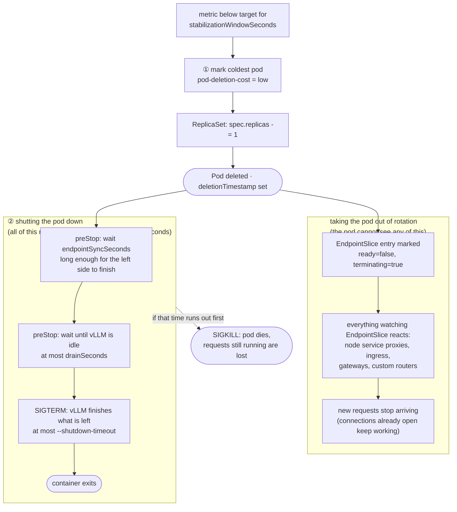

# LLMScaler

`autoscaling.modelsphere.dev/v1alpha1` kind `LLMScaler` points at a scalable workload and drives its replica count from a metrics source.

- **Target** (`spec.targetRef`): any `Deployment`, `StatefulSet`, or `LeaderWorkerSet` (handled generically via the unstructured client).
- **Metric provider** (`spec.metricProvider`): where the scaling signal comes from — `Prometheus` (default) or `Custom`. The two are alternatives, not layers: `Custom` replaces Prometheus outright and there is no fallback between them. See [Custom metric provider](#custom-metric-provider).
- **Metrics** (`spec.metrics`, `Prometheus` provider only): each entry is a **PromQL query** plus a per-replica `target`, evaluated against `spec.serverAddress`. The query **must** return a single aggregated value (e.g. wrap it in `avg(...)`), with label filters baked in — a result vector of more than one series is rejected rather than resolved to an arbitrary sample, so aggregate away every label the source varies on (`backend`, `model`, `route`, `pod`). Instant (`avg(...)`) and range (`avg(avg_over_time(...[1m]))`) queries are both valid — nothing enforces one, it's a trade-off. As a rule of thumb, a short `avg_over_time([1m])` survives a missed scrape and filters single-sample spikes while keeping scale-up responsive, provided you keep the window short (~1m for bursty queue depth, ~2m for slower-moving KV-cache); down-conservatism is better handled by `scaleDown.stabilizationWindowSeconds` than by a long metric window. **Scope the query to this deployment's pods**, not just the model — otherwise multiple deployments serving the same model get averaged together. Filter on `namespace` plus a per-deployment label such as `app` (the chart's ServiceMonitor exposes `app` via `podTargetLabels`; `namespace` is always present, and matters because release names can repeat across namespaces). Example: `query: avg(vllm:kv_cache_usage_perc{namespace="default", app="opt-125m-vllm"})`, `target: "0.8"`. The same applies to `scaleDown.deletionCostQuery`.
- **Headers** (`spec.serverHeaders`): arbitrary headers sent with every metric-fetch request (e.g. `Authorization` for a secured Prometheus or decision server).

## CRD specification

| | |
| --- | --- |
| Group / version | `autoscaling.modelsphere.dev/v1alpha1` |
| Kind | `LLMScaler` (list `LLMScalerList`) |
| Resource | `llmscalers` (singular `llmscaler`) |
| Scope | Namespaced |
| Subresources | `status` |

The target is looked up **in the `LLMScaler`'s own namespace** — `targetRef` has no `namespace` field, so a scaler cannot drive a workload in another namespace.

### `spec`

| Field | Type | Required | Default | Description |
| --- | --- | --- | --- | --- |
| `targetRef` | object | ✔ | — | Workload to scale. See below. |
| `metricProvider` | string | | `Prometheus` | `Prometheus` or `Custom`. Selects the scaling signal source; see [Custom metric provider](#custom-metric-provider). |
| `customProvider` | object | | — | Decision-server settings. Required when `metricProvider: Custom`, ignored otherwise. See below. |
| `serverAddress` | string | ✔ | — | Metric source endpoint. Under `Prometheus`, the query API (e.g. `http://prometheus-operated.monitoring.svc:9090`) — queries go to `{serverAddress}/api/v1/query`. Under `Custom`, the decision server's base URL. |
| `serverHeaders` | map[string]string | | — | Extra HTTP headers sent with every metric fetch (e.g. `Authorization`). Values are used verbatim. |
| `minReplicas` | int32 | ✔ | — | Lower bound. Minimum `0` — set it to `0` for scale-to-zero. |
| `maxReplicas` | int32 | ✔ | — | Upper bound. Minimum `0` — `0` pins the fleet at zero replicas (with `minReplicas: 0` this disables scaling entirely). |
| `metrics` | []object | ✔ under `Prometheus` | — | Metrics driving the replica count; the **largest** recommendation across entries wins. Rejected as empty under `Prometheus`, unused under `Custom`. See below. |
| `syncPeriodSeconds` | int32 | | `15` | Interval between metric evaluations (the `RequeueAfter` that paces each scale step). |
| `retryPeriodSeconds` | int32 | | `10` | Requeue interval used instead of `syncPeriodSeconds` when the target is missing or a sync errors. |
| `deferTimeoutSeconds` | int32 | | `600` | How long the rollout or settle guard may hold a scale action before it is applied anyway. `0` never forces, so the guards may then defer indefinitely. Measured from `status.deferredSince`, so it survives an operator restart. A forced write does not restart the clock: while a guard still matches, later steps proceed at the sync pace. The clock is cleared only when a sync finds no guard matching. The forced write is the same write the guard held back, including the `maxStepReplicas` cap. |
| `scaleDown` | object | | see below | Scale-down damping and cache-aware teardown. |
| `preemption` | object | | — | `enable` (bool), `priorityClass` (string). Accepted by the API but **not implemented** by the controller — setting it does nothing today. |

### `spec.targetRef`

| Field | Type | Required | Description |
| --- | --- | --- | --- |
| `apiVersion` | string | ✔ | e.g. `apps/v1`, `leaderworkerset.x-k8s.io/v1`. |
| `kind` | string | ✔ | `Deployment`, `StatefulSet`, or `LeaderWorkerSet`. Read and written generically through the unstructured client, so any kind exposing `spec.replicas` plus `status.readyReplicas` works; the rollout guard and cache-aware victim selection are `Deployment`-only. |
| `name` | string | ✔ | Name of the target in the `LLMScaler`'s namespace. |

### `spec.metrics[]`

| Field | Type | Required | Description |
| --- | --- | --- | --- |
| `name` | string | | Identifier for this metric in logs and events. |
| `query` | string | ✔ | PromQL returning a **single** aggregated, per-replica value — more than one series is an error, not a sample to pick from. See the `spec.metrics` notes above for scoping guidance. |
| `target` | string | ✔ | Desired per-replica value, as a quoted number on the same scale as the query (`"0.8"` against a 0–1 ratio, `"80"` against a 0–100 series). Must be finite and positive; a `%` suffix is rejected rather than guessed at. |

### `spec.customProvider`

Only read when `metricProvider: Custom`.

| Field | Type | Required | Default | Description |
| --- | --- | --- | --- | --- |
| `serviceId` | string | ✔ | — | The service whose decision to read. Sent as the `serviceId` query parameter **and** matched against `decisions[].serviceId` in the reply. |
| `namespace` | string | | — | Narrows the match to decisions carrying this namespace. Only needed if the server can report the same `serviceId` in more than one — a `serviceId` matching several decisions is an error, not a choice. |
| `path` | string | | `/decisions` | Request path on `serverAddress`. |

### `spec.scaleDown`

| Field | Type | Default | Description |
| --- | --- | --- | --- |
| `stabilizationWindowSeconds` | int32 | `0` | Hold replicas at the highest recommendation seen within this window. `0` disables it. Scale-up is unaffected. |
| `maxStepReplicas` | int32 | `0` | Maximum replicas removed per scale-down step; `0` means unlimited. Minimum `0`. Bounds the size of a step, not the interval between steps. |
| `behavior` | string | `CacheAware` | `CacheAware` biases deletion toward the coldest pods via `controller.kubernetes.io/pod-deletion-cost`; `None` leaves deletion order to the workload controller. |
| `deletionCostQuery` | string | — | PromQL returning one series per pod, each carrying a `pod` label; the sample value becomes that pod's deletion cost and the lowest is deleted first. Empty falls back to newest-pod-first. Only consulted when `behavior: CacheAware` **and** `metricProvider: Prometheus` — it is PromQL, and a decision server has no query API to run it against. |

### `status`

| Field | Type | Description |
| --- | --- | --- |
| `currentReplicas` | int32 | The target's ready replicas at the last sync, read raw (`0` when the field is missing). The scaling ratio uses this number, except that a ready count of `0` falls back to `spec.replicas` for the ratio only. |
| `desiredReplicas` | int32 | Last recommendation after clamping to min/max and scale-down stabilization, but **before** the `maxStepReplicas` cap. While a step cap is walking the fleet down it therefore reports the destination, not the replica count just written. |
| `appliedReplicas` | int32 | The target's `spec.replicas` after this sync: the value just written, or the unchanged value when the sync deferred or had nothing to do. This is the replica count left on the target, separate from the `desiredReplicas` recommendation. |
| `deferredSince` | metav1.Time | When the current deferral started. Set on the first sync that holds a scale action back. Kept across guard reason changes, no-op syncs while a guard still matches, and forced writes. Cleared only when a sync finds no guard matching (a normal write, or a no-op with no guard). A no-op does not start it. Stored in status so it survives an operator restart. |
| `observedGeneration` | int64 | `metadata.generation` at the last status write. |
| `lastScaleTime` | metav1.Time | When the controller last successfully wrote `spec.replicas` on the target. Set on a normal write and on a write forced after the deferral timeout. Left unchanged on a no-op, a deferral, pacing, or an error. |
| `conditions` | []metav1.Condition | `Ready`, `DecisionAvailable`, `AbleToScale`, and `ScalingLimited`. See [Conditions](#conditions). `ScalingLimited` never affects `Ready`. |

`kubectl get llmscalers` prints `MinReplicas`, `MaxReplicas`, `CurrentReplicas`, `DesiredReplicas`, `Ready` (the `Ready` condition status), `AbleToScale` (the `AbleToScale` condition status), and `Scaling` (the `AbleToScale` condition reason). `ScalingLimited` is not a printed column.

### Conditions

Read `Ready` for overall health. `AbleToScale=True` is the normal state, including while a guard holds the write. `DecisionAvailable` is whether this sync has a usable scaling signal, for both providers (HPA `ScalingActive`). `ScalingLimited` is whether a limit bound the count this sync (HPA `ScalingLimited`); it never affects `Ready`. `AbleToScale` matches HPA `AbleToScale`. `Ready` matches KEDA `Ready`. Every condition carries the `metadata.generation` of the sync that last wrote it as its `observedGeneration`. `AbleToScale` replaces the earlier `ScalingDeferred` condition (polarity inverted; `NotDeferred` became `Synced`). Objects created before this change may keep a stale `ScalingDeferred` condition; clients should prefer `AbleToScale` and ignore `ScalingDeferred`, and it can be removed with `kubectl patch --subresource=status`.

| Type | Status | Reason | Set when |
| --- | --- | --- | --- |
| `Ready` | `True` | `Synced` | `AbleToScale` is not `False` and `DecisionAvailable` is not `False`. A write (`scaled 3 -> 5`), a no-op (`replica count is at the step target`), a guard holding the write, paced forced writes included (`scale action deferred: <reason>; see AbleToScale`), and a write forced after the timeout (still `scaled X -> Y`). |
| `Ready` | `False` | `InvalidSpec` | Copied from `AbleToScale` when `targetRef.apiVersion` does not parse (same message; the sync stops), or from `DecisionAvailable` when `metricProvider` is `Custom` and `customProvider` is not set (`spec.customProvider is not set`; the replica count is held at `spec.replicas`, apart from the min/max bounds, and `AbleToScale` still describes the scale decision). If that scaler's target is also missing, the read runs first and Ready is `TargetNotFound` instead. |
| `Ready` | `False` | `TargetNotFound` | `AbleToScale` is `False` for the same reason. Getting the target returned NotFound. `DecisionAvailable`, `ScalingLimited`, `deferredSince`, and the replica counts are left as they are. Retried after `retryPeriodSeconds`. |
| `Ready` | `False` | `TargetUnreadable` | `AbleToScale` is `False` for the same reason. Getting the target failed for another reason. Handled like `TargetNotFound`. |
| `Ready` | `False` | `TargetWriteFailed` | `AbleToScale` is `False` for the same reason. Writing `spec.replicas` failed (`could not write spec.replicas: ...`). `deferredSince` and the replica counts are left as they are. The `DecisionAvailable` and `ScalingLimited` from this sync are kept and do not decide Ready. The error is returned, so the sync is retried with backoff. A missing `customProvider` does not outrank this. |
| `Ready` | `False` | `DecisionUnavailable` | `DecisionAvailable` is `False` this sync with this reason, under Custom or Prometheus. Same message. The replica count is held at `spec.replicas`, apart from the min/max bounds. `AbleToScale` still describes the scale decision. `ScalingLimited` is left as it is. |
| `DecisionAvailable` | `True` | `DecisionReceived` | Custom provider: a decision was read this sync. Message: `decision server recommends N replicas`. |
| `DecisionAvailable` | `True` | `MetricsAvailable` | Prometheus provider: at least one metric evaluated this sync. Message: `evaluated K of M metrics; recommends N replicas`. N is the raw maximum before clamping and stabilization. |
| `DecisionAvailable` | `False` | `DecisionUnavailable` | No usable signal this sync, so the replica count is held at `spec.replicas`, apart from the min/max bounds. Custom: `custom provider returned no decision: <err>` (request failed, unknown schema, or no usable decision). Prometheus: `no prometheus metric could be evaluated`, followed by `: <last err>` when a query failed, returned no data, was NaN/Inf, or the target did not parse. `ScalingLimited` is left as it is. |
| `DecisionAvailable` | `False` | `InvalidSpec` | Custom provider and `spec.customProvider` is not set. Message: `spec.customProvider is not set`. The replica count is held at `spec.replicas`, apart from the min/max bounds. `ScalingLimited` is left as it is. |
| `AbleToScale` | `True` | `Synced` | No guard holds, and the stabilization window did not raise this sync's clamped recommendation. A normal write (`scaled X -> Y`), or a no-op with no deferral running (`replica count is already at the step target`). `deferredSince` is cleared. |
| `AbleToScale` | `True` | `RolloutInProgress` | A guard holds the write and this one matched first. A `Deployment` is mid-rollout: `observedGeneration < generation`, `updatedReplicas < spec.replicas`, or `replicas > updatedReplicas`. Covers the deferring case, a no-op while a deferral is already running, and forced-write pacing. Wins over `ScaleDownStabilized`. |
| `AbleToScale` | `True` | `ScaleDownSettling` | A guard holds the write and the rollout guard did not. A scale-down while `readyReplicas != spec.replicas`, or, when the terminating check is on (off by default), `terminatingReplicas > 0`. Same three hold cases as `RolloutInProgress`. Wins over `ScaleDownStabilized`. |
| `AbleToScale` | `True` | `DeferralTimedOut` | A guard still matched and `deferTimeoutSeconds` has elapsed since `deferredSince`, so the held write was applied. Same message as the Warning event. `deferredSince` is kept. Wins over `ScaleDownStabilized`. |
| `AbleToScale` | `True` | `ScaleDownStabilized` | The stabilization window returned a value higher than this sync's clamped recommendation, and no guard hold or `DeferralTimedOut` described the write. Message: `recent recommendations were higher than current one, applying the highest recent recommendation`. Not a guard: it does not start, keep, or clear `deferredSince`, and it does not emit `ScalingDeferred`. A stabilized no-op with no guard ends a deferral the same way a `Synced` no-op does. `Ready` stays `True`/`Synced`. |
| `AbleToScale` | `False` | `InvalidSpec` | `targetRef.apiVersion` does not parse. The sync stops before a recommendation, so `DecisionAvailable` and `ScalingLimited` are not updated. Message: `targetRef.apiVersion "<value>" does not parse: ...`. |
| `AbleToScale` | `False` | `TargetNotFound` | Getting the target returned NotFound. The sync stops before a recommendation. `DecisionAvailable`, `ScalingLimited`, `deferredSince`, and the replica counts stay untouched. |
| `AbleToScale` | `False` | `TargetUnreadable` | Getting the target failed for another reason. The sync stops before a recommendation. `DecisionAvailable`, `ScalingLimited`, `deferredSince`, and the replica counts stay untouched. |
| `AbleToScale` | `False` | `TargetWriteFailed` | Updating `spec.replicas` on the target failed. The `DecisionAvailable` and `ScalingLimited` computed earlier in that sync are kept. `deferredSince` and the replica counts stay untouched. |
| `ScalingLimited` | `True` | `TooFewReplicas` | The raw provider count, before clamping and before stabilization, was below `minReplicas`, and the step cap did not change the write. Message: `the desired replica count is less than the minimum replica count`. |
| `ScalingLimited` | `True` | `TooManyReplicas` | That raw count was above `maxReplicas`, and neither the step cap nor `TooFewReplicas` applied. Message: `the desired replica count is more than the maximum replica count`. |
| `ScalingLimited` | `True` | `ScaleDownLimit` | `spec.scaleDown.maxStepReplicas` changed this sync's write (`targetReplicas != recommendedReplicas`). This is HPA's behavior rate limit. It wins over a min/max clamp on the same sync. Message: `the desired replica count is decreasing faster than the maximum scale rate (maxStepReplicas N)`. There is no `ScaleUpLimit`: scale-up is never capped. |
| `ScalingLimited` | `False` | `DesiredWithinRange` | This sync had a usable signal and neither the min/max clamp nor the step cap bound the write. Message: `the desired count is within the acceptable range`. |

- Ready precedence, in this order: (1) `AbleToScale` `False` makes Ready `False` with that reason and message (`InvalidSpec` for an unparseable `targetRef.apiVersion`, `TargetNotFound`, `TargetUnreadable`, `TargetWriteFailed`). (2) `DecisionAvailable` `False` this sync makes Ready `False` with that reason and message (`InvalidSpec` when `customProvider` is not set, `DecisionUnavailable` when Custom or Prometheus has no usable signal). (3) Otherwise Ready is `True` / `Synced`. A write is `scaled X -> Y` (including a write forced after the timeout), a no-op is `replica count is at the step target`, and a guard hold, paced forced writes included, is `scale action deferred: <reason>; see AbleToScale`. `ScalingLimited` is not an input.
- `AbleToScale` `True` reasons, per sync: (1) a guard hold (`RolloutInProgress` or `ScaleDownSettling`), in all three hold cases — deferring a write, a no-op while a deferral is already running, and pacing a forced write — and `DeferralTimedOut` when the timeout forces the write; these describe the write and win. (2) `ScaleDownStabilized`, when the stabilization window returned a value higher than the clamped recommendation. (3) `Synced`. `ScaleDownStabilized` is not a guard: it does not start, keep, or clear `deferredSince`, and it does not emit `ScalingDeferred`. A stabilized no-op with no guard ends a deferral exactly as a `Synced` no-op does. `Ready` stays `True`/`Synced` on all three, with its own message.
- `ScalingLimited` is set only when this sync has a usable signal, once the recommendation and the step cap are known and before the target write, so a write failure persists it the way `DecisionAvailable` is persisted. When `DecisionAvailable` is `False` this sync it is left as it is, including on the first sync where it may be absent. The no-signal fallback is held at `spec.replicas`, apart from the min/max bounds, and that clamp does not update `ScalingLimited`. An unparseable `targetRef.apiVersion` or a failed target read stops before a recommendation and leaves it as it is. It never affects `Ready`, and it is not a printed column. Precedence, the constraint that bound the final write: (1) `ScaleDownLimit` when the step cap changed the write (`targetReplicas != recommendedReplicas`); (2) `TooFewReplicas` when the raw provider count, before clamping and before stabilization, is below `minReplicas`, else `TooManyReplicas` when that raw count is above `maxReplicas`; (3) `DesiredWithinRange`. Stabilization lifting the count afterwards does not clear a clamp reason. Only the step cap outranks the clamp. There is no `ScaleUpLimit` because scale-up is never capped.
- A missing signal therefore outranks a clean write or a deferral. An `AbleToScale` `False` outranks a `DecisionAvailable` `False` from the same sync, so a failed target write outranks a missing `customProvider`. A Custom scaler without `customProvider` whose target is also missing is read first, so Ready is `TargetNotFound` and `DecisionAvailable` is not evaluated. On the paths that stop before a recommendation, Ready comes from `AbleToScale` only, so a stale `DecisionAvailable` cannot decide it.
- `DecisionAvailable` is written on every sync that reaches a recommendation, for both providers. Switching `metricProvider` overwrites it on the next such sync. `ScalingLimited` is written on that same sync, before the write.
- An unparseable `targetRef.apiVersion` or a failed target read writes `AbleToScale`, `Ready`, and `status.observedGeneration` only. `DecisionAvailable`, `ScalingLimited`, the replica counts, `deferredSince`, and `lastScaleTime` are left untouched.
- A failed target write writes `AbleToScale`, `Ready`, `status.observedGeneration`, and the `DecisionAvailable` and `ScalingLimited` computed earlier in that sync. The replica counts, `deferredSince`, and `lastScaleTime` are left untouched. Ready copies `TargetWriteFailed`.

#### `AbleToScale` details

A no-op while a guard still matches leaves `deferredSince` unchanged. If it is set, the condition stays `True` with that guard's reason and a message that nothing needs writing this sync, the guard is still active, and the deferral clock keeps running. If it is nil, the condition is `True`/`Synced` (`replica count is already at the step target`): a no-op does not start a deferral. The same branch runs when the stabilization window raised the recommendation and no guard holds: `deferredSince` is cleared, the reason is `ScaleDownStabilized` instead of `Synced`, and `Ready` is still `True`/`Synced`.

While a guard is holding a write that has not yet reached `deferTimeoutSeconds`, the condition is `True` with that guard's reason. The message is `holding N replicas (wanted M): <guard>; deferred since <time>, will apply after Ns`, or `never forced (deferTimeoutSeconds is 0)` when the timeout is 0.

When the deadline has passed but a forced write already happened within the last sync period, the condition is `True` with the current guard reason and the message notes that the forced write is paced to one per sync period.

When the timeout forces the write, the condition is `True`/`DeferralTimedOut` with the same message as the Warning event, and `Ready` is `True`/`Synced` with `scaled X -> Y`.

Events, both on the `LLMScaler`:

- **Normal `ScalingDeferred`** when a deferral starts, and again if the guard reason differs from the previous `AbleToScale` reason (a previous `False`, `Synced`, `ScaleDownStabilized`, or `DeferralTimedOut` counts as changed). `ScaleDownStabilized` does not emit it. Rollout to settling is still one deferral, so `deferredSince` does not move. Not emitted on every sync, and not emitted by the forced write itself or by a no-op. After a `TargetNotFound` sync, a returning guard emits once.
- **Warning `DeferralTimedOut`** when the timeout forces the write. The message names the guard reason, how long the action was deferred, and the `from -> to` replica change. The write is the one the guard held back, still capped by `maxStepReplicas`. `deferredSince` is kept when the guard still matches, so the next stuck step does not wait out the timeout again. While the guard still matches, forced writes are paced to one per sync period.

### Example

```yaml
apiVersion: autoscaling.modelsphere.dev/v1alpha1
kind: LLMScaler
metadata:
  name: llmscaler-sample
spec:
  targetRef:
    apiVersion: apps/v1
    kind: Deployment
    name: vllm-opt-125m
  serverAddress: "http://prometheus-operated.monitoring.svc:9090"
  minReplicas: 1
  maxReplicas: 5
  syncPeriodSeconds: 15
  retryPeriodSeconds: 10
  deferTimeoutSeconds: 600
  metrics:
    # Scope the query to THIS deployment's pods (not just the model) so multiple
    # deployments serving the same model don't get averaged together.
    - name: kv-cache
      query: 'avg(avg_over_time(vllm:kv_cache_usage_perc{namespace="default", app="vllm-opt-125m"}[2m]))'
      target: "0.8"
  scaleDown:
    stabilizationWindowSeconds: 180
    maxStepReplicas: 1
    behavior: CacheAware
    deletionCostQuery: 'vllm:kv_cache_usage_perc{namespace="default", app="vllm-opt-125m"} * 100'
```

Kept in sync at `config/samples/autoscaling_v1alpha1_llmscaler.yaml`; the generated schema is `config/crd/bases/autoscaling.modelsphere.dev_llmscalers.yaml`.

## Custom metric provider

`metricProvider: Custom` replaces Prometheus with an external **decision server** that has already worked out how many replicas the service should have. Instead of measuring something per replica and dividing by a target, the operator asks a question and is handed the answer:

```
GET {serverAddress}{customProvider.path}?serviceId={customProvider.serviceId}
```

```console
$ curl http://10.98.120.218:80/decisions?serviceId=fallback-modelforge-01
{
  "apiVersion": "llmscaling.inference.x-k8s.io/v1alpha1",
  "decisions": [
    {
      "namespace": "modelforge",
      "serviceId": "fallback-modelforge-01",
      "replicas": {
        "active": 15
      }
    }
  ]
}
```

Only `decisions[].replicas.active` is read; every other field either identifies the decision or is ignored.

- **The count is absolute, not per-replica.** `active: 15` means fifteen replicas — the `ceil(readyReplicas × value / target)` ratio the Prometheus path applies has no counterpart here, and applying one would compound the server's own decision on every sync. `spec.metrics` is not consulted at all (and not required by the CRD) under this provider.
- **The CRD bounds still hold.** The count is clamped to `[minReplicas, maxReplicas]` and then goes through the same `scaleDown.stabilizationWindowSeconds` damping and `maxStepReplicas` pacing as any other recommendation. The server recommends; this operator keeps the rail. A decision of `0` is a real recommendation: with `minReplicas: 0` it scales the target to zero, otherwise it clamps up to `minReplicas`.
- **`apiVersion` selects the schema.** The reply says how to read itself, and only `llmscaling.inference.x-k8s.io/v1alpha1` is understood; anything else is refused rather than parsed hopefully, since a later schema is free to reuse `replicas` for something that is not an absolute count.
- **The reply is matched, not trusted.** `serviceId` is sent as a query parameter *and* checked against `decisions[].serviceId`, because what comes back is the server's choice — a decision for a service this scaler did not ask about must not be able to drive it. Exactly one decision must match; **more than one is an error**, the same rule (and the same reasoning) as a multi-series PromQL result. Set `customProvider.namespace` if the server reports the same `serviceId` in several namespaces.
- **A failure holds the fleet at `spec.replicas`, apart from the min/max bounds, and never reads as zero.** A server that is down, a non-200, an unknown `apiVersion`, no matching decision, or a decision with no `replicas.active` all skip that sync. The fallback is still clamped to min/max and still runs through scale-down stabilization — mirroring how an unevaluable PromQL query is handled. `ScalingLimited` is left as it is.
- **The outcome is on the status, not in the error log.** Every sync that reaches a recommendation sets `DecisionAvailable`, for both providers, and switching `metricProvider` overwrites it. Under Custom it is `True` (`DecisionReceived`, `decision server recommends N replicas`) when a decision arrived, `False` (`DecisionUnavailable`, `custom provider returned no decision: <err>`) when the replica count was held at `spec.replicas`, apart from the min/max bounds, and `False` (`InvalidSpec`, `spec.customProvider is not set`) when `customProvider` is missing. `Ready` copies that reason and message when `AbleToScale` is not already `False`. Check it with `kubectl get llmscaler <name> -o jsonpath='{.status.conditions}'`.
- **`scaleDown.deletionCostQuery` is ignored** under this provider: it is PromQL and `serverAddress` is now a decision server, so victim selection falls back to the newest-pod-first heuristic. The controller logs when it skips it.

```yaml
apiVersion: autoscaling.modelsphere.dev/v1alpha1
kind: LLMScaler
metadata:
  name: llmscaler-custom-provider-sample
spec:
  targetRef:
    apiVersion: apps/v1
    kind: Deployment
    name: fallback-modelforge-01
  metricProvider: Custom
  serverAddress: "http://llm-decision-server.modelforge.svc:80"
  customProvider:
    serviceId: fallback-modelforge-01
    namespace: modelforge
    path: /decisions
  minReplicas: 1
  maxReplicas: 20
  scaleDown:
    stabilizationWindowSeconds: 180
    maxStepReplicas: 1
```

Kept in sync at `config/samples/autoscaling_v1alpha1_llmscaler_customprovider.yaml`.

## Scaling algorithm

Standard HPA math, evaluated every `spec.syncPeriodSeconds`:

```
desired = ceil(readyReplicas × currentValue / targetValue)   # max across metrics
desired = clamp(desired, minReplicas, maxReplicas)
```

Under `metricProvider: Custom` only the first line is replaced — `desired` is the decision server's `replicas.active`, and everything from the clamp onward is identical.

- Computed off the target's **ready** replicas (actual serving capacity), so it does not compound on pods that were just requested but haven't started. A ready count of 0 falls back to `spec.replicas` for this ratio only; `status.currentReplicas` and the settle guard keep the raw count, so a fully-unready fleet is not treated as settled.
- **A metric that cannot be measured is skipped, not read as zero.** A query that errors, returns an empty vector, returns more than one series, or returns `NaN`/`Inf` contributes nothing to that sync; when *every* metric is skipped the replica count is held at `spec.replicas`, apart from the min/max bounds (the clamp and scale-down stabilization still run, so `spec.replicas: 1` with `minReplicas: 3` writes `scaled 1 -> 3`). `ScalingLimited` is not updated on that sync. This matters when mixing a metric that drives scale-up with a guardrail: `histogram_quantile` over a histogram with no observations in the window returns `NaN`, and were that read as 0 a guardrail could recommend `minReplicas` on its own whenever the primary metric happened to fail. For the same reason, do not append `or vector(0)` to a guardrail — reserve it for the metric that drives scale-up, where a genuine zero should scale in.
- The controller watches the `LLMScaler` with `GenerationChangedPredicate`, so its own status writes don't re-trigger reconciliation. Periodic evaluation is driven by `RequeueAfter`: `syncPeriod` on a normal sync, or sooner while a write is held and the deferral deadline (or the forced-write pace) is closer than that. The wait is never under one second.
- **Rollout guard** (both directions): while a Deployment target is mid-rollout — the controller has not observed the latest spec, not every replica is on the new pod template, or old-template pods still exist — scaling is deferred. Changing `spec.replicas` in the middle of a rollout spreads that delta across both ReplicaSets, the one on the old template and the one on the new, so the guard holds scale-up and scale-down alike. New pods also start with cold KV caches that distort the metric average and would be mis-picked as scale-down victims.
- **Scale Down**
    - **Scale-down stabilization** (`spec.scaleDown.stabilizationWindowSeconds`, 0 = off): replicas are held at the highest recommendation seen within the window, so a brief metric dip doesn't shrink the fleet. When the window returns a value higher than this sync's clamped recommendation, `AbleToScale` is `True`/`ScaleDownStabilized` unless a guard hold or `DeferralTimedOut` wins. That reason is not a guard.
    - **Scale-down step cap** (`spec.scaleDown.maxStepReplicas`, 0 = unlimited): at most this many replicas are removed per scale-down action, so a collapsed metric walks the fleet down (`10 → 8 → 6 → …` at `maxStepReplicas: 2`) instead of bursting from N straight to `minReplicas`. This is the knob for "don't throw away all the warm caches at once". Note it bounds the *size* of a step, not the interval between steps — that is the settle guard's job (see below). When the cap changes this sync's write, `ScalingLimited` is `True`/`ScaleDownLimit`. There is no `ScaleUpLimit`.
- **Settle guard**: a scale-down waits until the target has absorbed the previous replica count (`status.readyReplicas == spec.replicas`), using the raw ready count. A missing count is 0, so a fully-unready fleet does not count as settled. Scale-up is not gated on this. A further check that `status.terminatingReplicas == 0` covers the drain window but is off by default; with it off, a pod leaves `readyReplicas` as soon as it has a deletion timestamp, and the guard only bridges the gap between the write and the workload controller reflecting it in status.
- **Deferral timeout** (`spec.deferTimeoutSeconds`, default 600; `0` never forces): the guards above are otherwise unbounded, so a stuck rollout — progress deadline exceeded, a paused Deployment, a quota rejection, or pods stuck Pending — freezes the scaler in both directions, including the scale-down that would free capacity. Once a scale action has been held for this long, measured from `status.deferredSince`, the controller applies the same write the guard held back (still capped by `maxStepReplicas`) and emits a `DeferralTimedOut` warning. The clock keeps running across that write, across a change of guard reason, and across a no-op while a guard still matches, so a target that stays stuck steps at the normal sync pace instead of waiting out the timeout again. `deferredSince` is cleared only when a sync finds no guard matching (a normal write, or a no-op with no guard). A no-op does not start the clock, and a no-op while a guard still matches does not clear it. With `0` the guards may defer indefinitely. While a write is held and the timeout is non-zero, the next sync waits the earlier of `syncPeriod` and the time remaining until the deadline; a forced write that is only waiting out the one-per-sync-period pace waits the earlier of `syncPeriod` and the time left on that pace. Either wait is at least one second.
- **Scale-up is immediate** — no scale-up stabilization window and no scale-up step cap, so capacity is added as soon as the metric warrants it (the fast-up / slow-down shape) and `ScalingLimited` has no `ScaleUpLimit`. It stays bounded because `desired` is computed off *ready* replicas (no compounding) and clamped to `maxReplicas`. A scale-up rate cap for slow-starting pods is intentionally not implemented — vLLM pods are heavy, so a `1 → maxReplicas` jump can start several at once and briefly overshoot before they serve; add a step cap only if that overshoot actually hurts you.
- **Scale-to-zero** (`minReplicas: 0`): an idle metric recommends `0` and the target is scaled all the way down. Waking back up works on both providers: under `Custom` the decision server hands back an absolute count, and under `Prometheus` the ratio is evaluated against a single-replica baseline (a fleet of zero has no per-replica measurement to scale off, so `ceil(value / target)` is used). A metric that cannot be evaluated while at zero (e.g. a per-pod query returning no series) holds the fleet at `spec.replicas`, apart from the min/max bounds — at zero, that stays zero — rather than waking it.

## Cache-aware scale-down

Deleting a pod with a hot KV cache throws away a warm cache someone paid for. `spec.scaleDown.behavior`, default `CacheAware`; `None` to turn off. Two steps:

1. **Preferred victim selection** — choose the coldest pod to delete.
2. **Graceful drain** — let that pod finish what it is doing before it goes, and force it to stop if it takes too long.

Deleting a pod starts two things at the same time, and the pod only controls the one on the right:



Neither side waits for the other. The kubelet starts `preStop` without knowing whether the pod has been taken out of the load balancer yet, and the pod has no way to ask — so it just waits `endpointSyncSeconds` first and lets the left side catch up. That is the one number you may need to tune.

### 1. Preferred victim selection

Before lowering `spec.replicas`, the controller sets a low `controller.kubernetes.io/pod-deletion-cost` on the pods being removed, so the ReplicaSet deletes those first.

- Set **only when scaling down**, and **only on the pods being removed** — never on every metric check, because Kubernetes warns that frequent updates to this annotation overload the apiserver.
- It is a **hint, not a guarantee**: unready pods are still deleted first. It also works on **Deployment/ReplicaSet only** — StatefulSet and LWS delete by ordinal and ignore it.
- It only edits an annotation on the running pod, so it does **not** restart anything. (Editing the Deployment's pod *template* would start a rollout; this does not.)
- Two ways to decide which pod is coldest:
  - **Ask Prometheus** — `spec.scaleDown.deletionCostQuery` is a query returning one result per pod (with a `pod` label), run against `spec.serverAddress`. Each pod's value becomes its cost, and the lowest goes first. E.g. `vllm:kv_cache_usage_perc{namespace="default"} * 100` keeps the fuller caches.
  - **Guess** — with no query set, the newest pod is assumed to have the coldest cache. Also what `metricProvider: Custom` uses, since the query is PromQL and there is no Prometheus to run it against.

### 2. Graceful drain

A pod that is being deleted keeps serving until it is out of the load balancer and its remaining requests are done. `test/charts/vllm-mock` sets up the three steps on the right-hand side of the diagram:

- **Wait `endpointSyncSeconds`** — always waits the full time, even on an idle pod, because there is nothing to check. Set it to however long whatever routes traffic to this pod needs to notice it is going away: Cilium suggests ~1s for a ClusterIP Service, ~10s if an external load balancer is in front.
- **Wait for vLLM to go idle** — watches `vllm:num_requests_running` and `vllm:num_requests_waiting` and stops as soon as both are zero, waiting at most `drainSeconds`. An idle pod shuts down right away instead of waiting the whole time. If the check fails, it assumes the pod is still busy and keeps waiting.
- **`--shutdown-timeout`** (vLLM ≥ 0.18.0) — once SIGTERM arrives, vLLM's default of `0` **kills** any request still running. Setting it above zero lets those requests finish instead.

All three share the same `terminationGracePeriodSeconds` budget. When it runs out the kubelet stops waiting and sends SIGKILL, and any request still running dies with the pod — the one outcome all of this exists to avoid. It can land in any of the three steps, not just the last one, so the chart refuses to render if `endpointSyncSeconds + drainSeconds + shutdownTimeout` adds up to more than the budget.

## TODO

- [ ] **switch operator scale write to Server-Side Apply**. Move `spec.replicas` writes from the current client-side `r.Update` (PUT) to client.Apply/SSA with a stable, explicit field manager and only `spec.replicas` in the apply set, so the operator owns that field outright regardless of Helm. Recorded with the current-state details and the reason (ownership is presently incidental, so Helm could still thrash if it re-asserts the field).

## Testing the scale operation

Tiny models (e.g. `facebook/opt-125m`) never fill their KV cache enough to trip a real threshold. The `vllm-mock` chart ships an optional `metricsMock` (`--set metricsMock.enabled=true`) that returns a fixed metric value, so the scaler can be driven to scale up/down deterministically. See `test/charts/vllm-mock/values.yaml`.
